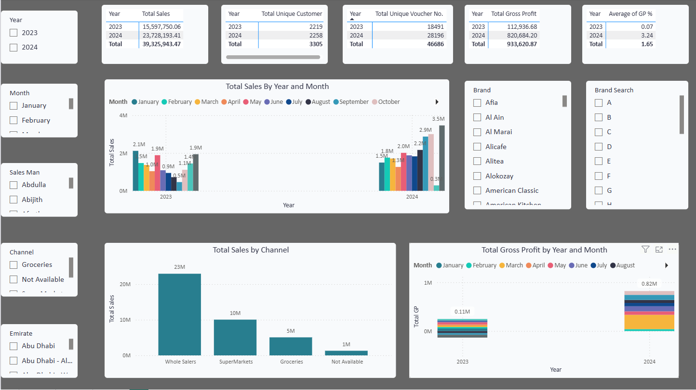
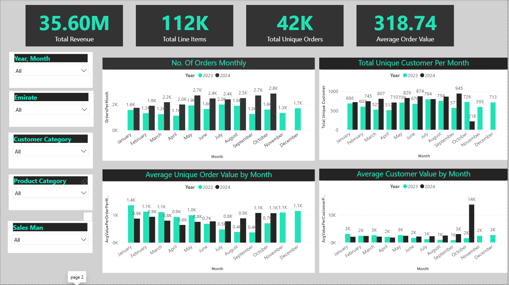
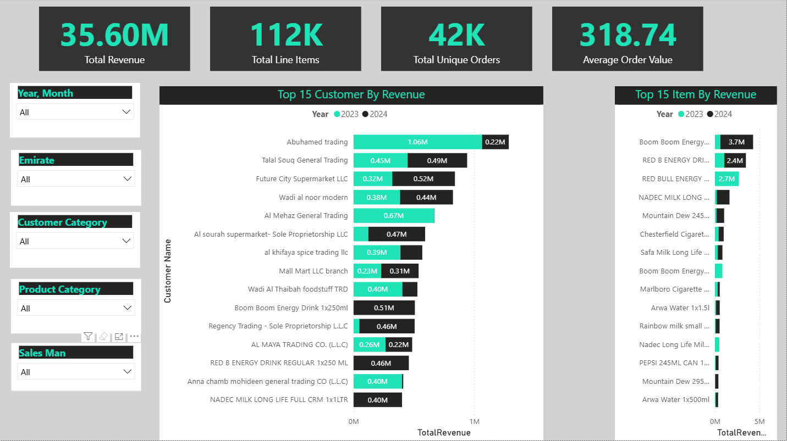
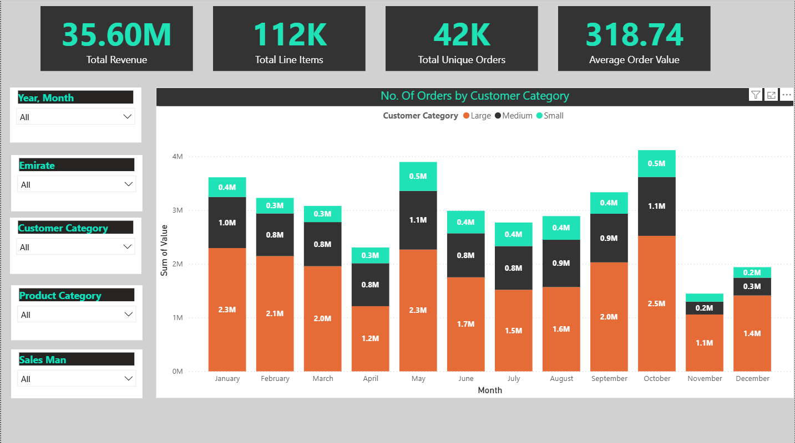
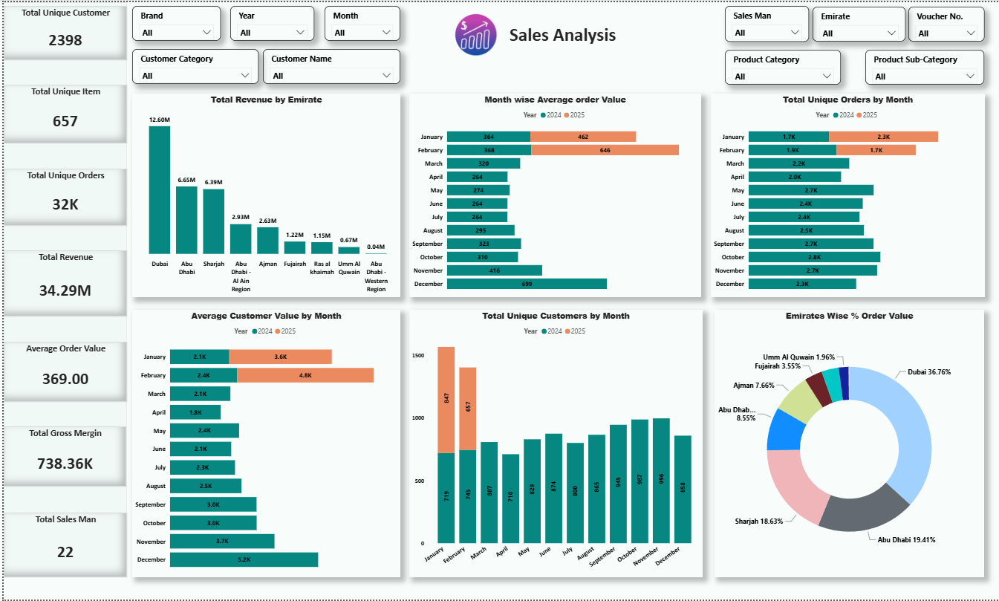
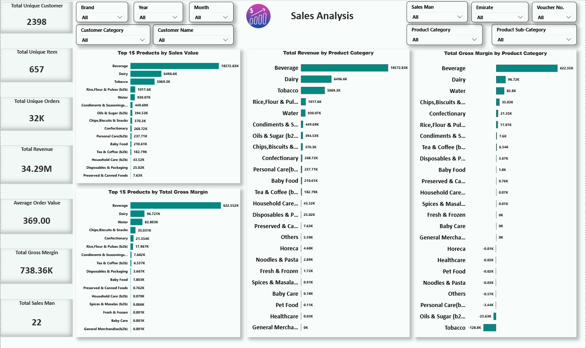
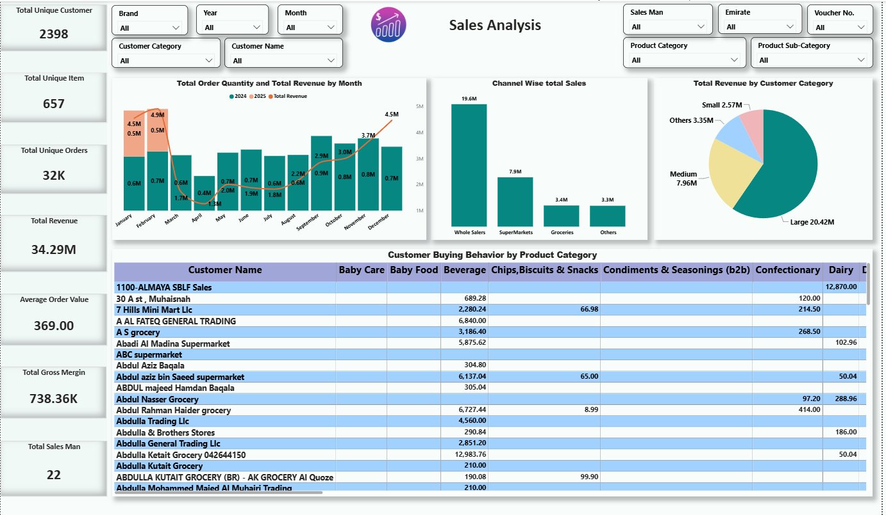

# FMCG & Retail Sales Analysis Dashboard

A multi-page interactive data analytics dashboard designed to monitor commercial sales performance, track operational metrics, and uncover consumer purchasing behavior across the United Arab Emirates (UAE).

## 📊 Core Performance Metrics
* **Total Revenue:** 35.60M
* **Total Line Items:** 112K
* **Total Unique Orders:** 42K
* **Average Order Value:** 318.74

---

## 📈 Key Data Insights

### 1. Regional Dominance (Geographic Mix)
* **Dubai** represents the largest market share, driving **36.76%** of all order values.
* **Abu Dhabi** (**19.41%**) and **Sharjah** (**18.63%**) serve as secondary strongholds. 
* Smaller regions like Umm Al Quwain and Fujairah represent expansion opportunities with minimal current footprints.

### 2. Category Performance & Margin Killers
* **Beverages** are the primary commercial driver, securing the highest overall sales value and bringing in a commanding **622.55K** in total gross margins.
* **Tobacco** presents a critical risk structure: while it sits as the 3rd highest product category by revenue volume, it suffers from severe negative returns, registering a net loss of **-128.8K** in gross margin.

### 3. Product & Customer Concentration
* The top revenue-generating item is **Boom Boom Energy Drink**, bringing in **3.7M** single-handedly, closely followed by Red Bull Energy Drink. 
* **Abuhamed Trading** sits as the most valuable B2B client profile, generating **1.06M** in 2023 and expanding into 2024.

### 4. Seasonality & Customer Segmentation
* Sales patterns show sharp seasonal drops in **April** and **November/December**. Peak buying behavior consistently surges in **May** and **October**.
* **Large enterprise accounts** make up the predictable baseline of monthly volumes, but **Medium accounts** show the highest transactional volatility month-over-month.

---

## 🖼️ Dashboard Gallery

### Executive Overview & Financial Health

---

### 2. Monthly Trend Analysis & Customer Valuation

---

### 3. Customer & Product Revenue Rankings

---

### 4. Segmented Value Distribution

---

### 5. Geographic Market Share & Order Distributions

---

### 6. Catalog Profitability & Product Category Health

---

### 7. B2B Client Buying Patterns & Channel Dynamics

---

## 🛠️ Tech Stack
* **BI Tool:** Power BI
* **Data Processing:** Power Query & DAX
