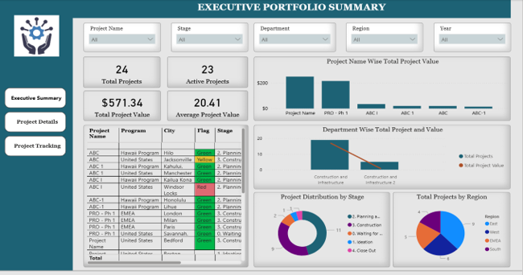
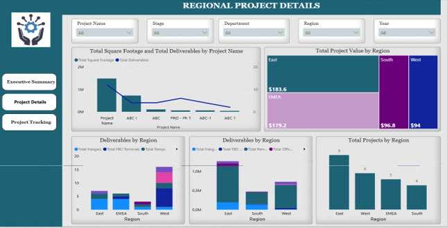
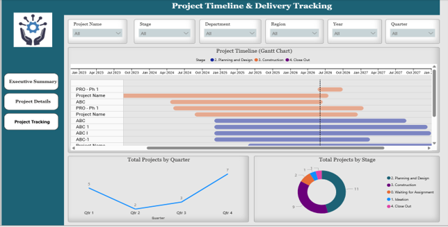

# Project Portfolio Management Dashboard

An interactive, multi-page Power BI dashboard designed to provide executives and stakeholders with end-to-end visibility into project lifecycles, financial metrics, regional asset distributions, and delivery timelines.

## 📊 Dashboard Pages & Insights

### 1. Executive Portfolio Summary
Provides a high-level operational overview of the entire project portfolio to support rapid executive decision-making.

* **Key Metrics:** Displays crucial KPIs including **Total Projects (24)**, **Active Projects (23)**, **Total Project Value ($571.34M)**, and **Average Project Value ($20.41M)**.
* **Core Visuals:** Features project-wise financial breakdowns, stage distributions via donut charts, and a detailed project log table utilizing conditional risk-flag formatting (Green/Yellow/Red).

### 2. Regional Project Details
Focuses on geographical asset footprints, infrastructure capacity, and localized project values.

* **Core Visuals:** 
  * A **Regional Value Treemap** breaking down investments (East: \$183.6M, EMEA: \$179.2M, South: \$96.8M, West: \$94M).
  * Comprehensive asset charts tracking physical deliverables like Hangars, FBO Terminals, Ramps, and Offices.
  * Square footage and volumetric capacity metrics per project name.

### 3. Project Timeline & Delivery Tracking
Enables schedule management, pipeline visibility, and chronological risk mitigation.

* **Core Visuals:** Features a comprehensive **Gantt Chart** tracking multi-year project lifecycles, start-to-end targets, and chronological milestone trends alongside quarterly project completion velocity.

---

## 🎛️ Global Interactive Filters
To allow granular data exploration, users can cross-filter all visuals across all three pages simultaneously using the following parameters:
* **Project Name:** Drill down into specific initiatives.
* **Stage:** Filter by lifecycle position (*Ideation, Planning & Design, Construction, Waiting for Assignment, Close Out*).
* **Department & Region:** Segment by internal teams or geographical boundaries (*East, West, EMEA, South*).
* **Temporal Slicers:** Filter data dynamically by *Year* and *Quarter*.

---

## 🛠️ Built With
* **Power BI Desktop** - Report authoring, DAX modeling, and visual design.
* **Power Query** - ETL processes and data shaping.
