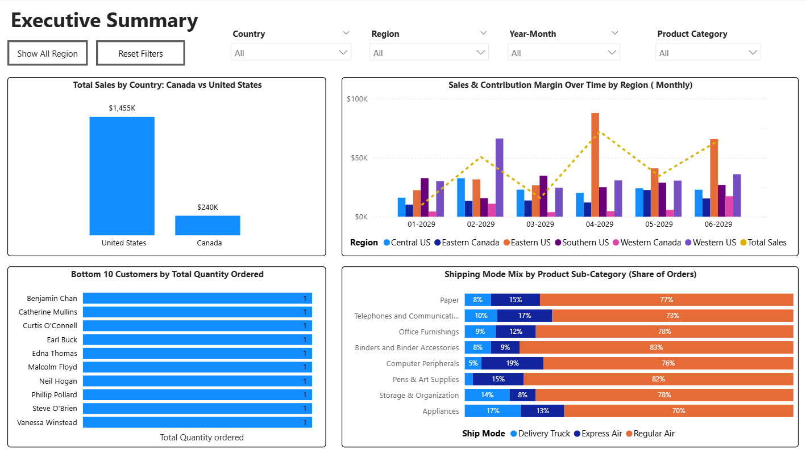

📈 Executive Summary Dashboard

Key Focus: High-level overview of North American sales performance, regional monthly trends, logistics efficiency, and customer purchasing tail-ends.

🔍 Core Data Insights

• Geographic Revenue Concentration: The United States drives the vast majority of top-line revenue at $1,455K, compared to Canada at $240K.
• Regional Performance Volatility: Monthly sales analysis reveals a massive revenue surge in April 2029 driven entirely by the Eastern US region, contrasted by a sharp performance dip across most regions in March 2029.
• Shipping & Logistics Dependency: Across almost all major product sub-categories (Paper, Office Furnishings, Appliances), Regular Air serves as the dominant shipping vehicle, commanding over 70%–83% of total order shares. Delivery Trucks are utilized least frequently, peaking slightly for Storage & Organization items at 14%.
• Customer Distribution Tail: The bottom 10 customers by order frequency exhibit highly fragmented, low-volume behavior, each accounting for only a single (1) item ordered.

🖼️ Visualization Preview

